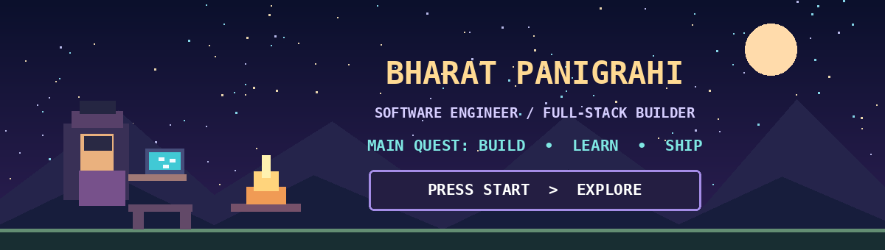

<div align="center">



# ⚔️ Hey, I'm Bharat!

**Software Engineer • Builder of things • Curious about how systems work**

*Turning ideas into side quests, one commit at a time.*

[](https://github.com/Bharat1056)
[](https://github.com/Bharat1056?tab=repositories)

</div>

---

### 🧙 Character sheet

```text
PLAYER       Bharat Panigrahi
CLASS        Software Engineer / Full-Stack Builder
MAIN QUEST   Build useful products and understand systems deeply
SIDE QUESTS  Go • Distributed Systems • AI Tooling • System Design
CURRENT XP   Always learning
```

I enjoy building products end-to-end — from interfaces people love using to APIs, queues, databases, and the infrastructure behind them. I'm especially curious about what happens *after* a request leaves the browser.

### 🎒 My inventory

**Languages:** Go · Java · TypeScript · JavaScript · SQL

**Frontend:** React · Next.js · Tailwind CSS · Redux · React Query

**Backend:** Node.js · Spring Boot · REST APIs · Prisma

**Systems & data:** PostgreSQL · MongoDB · Redis · Kafka · RabbitMQ

**Tools:** Docker · Git · Linux · AWS · Nginx

### 🗺️ Quest log — things I've built

| Quest | What I explored |
| --- | --- |
| **Vibe** | AI-assisted website generation, agent workflows, and sandboxed execution |
| **Snipkit** | Developer tooling and making reusable code easier to manage |
| **Vibe Workflow** | Visual workflow orchestration and AI automation |
| **URL Shortener** | Spring Boot APIs, redirects, persistence, and analytics |
| **E-Commerce Microservices** | Service boundaries, event-driven messaging, and distributed architecture |
| **Xui** | Reusable React UI components and developer experience |

**[Explore my repositories →](https://github.com/Bharat1056?tab=repositories)**

### 🔮 Currently leveling up

- Designing reliable backend services with **Go** and **Java**
- Understanding **distributed systems**, concurrency, and messaging
- Experimenting with **AI agents**, automation, and developer tools
- Practicing **system design** and building projects that teach me something new

### 📜 Adventure Log

<div align="center">

**Every commit is a little more XP.**

[](https://github.com/Bharat1056)

*Building, learning, and leveling up — one commit at a time.*

</div>
